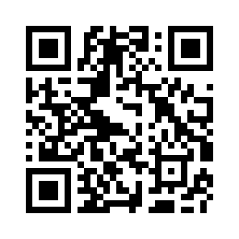
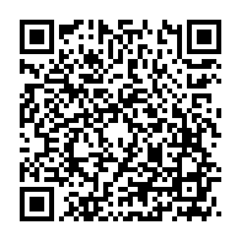

## Crypto

### USDT or TRX on TRON (TRC20)

```
THR2gbWMaTZh8ACk3VYAAyNRVffvdTRikj
```

### USDT or USDC on BNB Smart Chain (BEP20) or Ethereum (ERC20)

```
0x7c2dF1867f5AaEE807a835fB3c55E4de4507888A
```

### Monero (XMR)

```
4AYwwN8qMQCSUb3XfwzfrLNPMHfDme6U7CmNtQY4idCF8GtHHLG68VA3iZK867ypuKFr8J7CjXiJ96eFUA2T6aLVRUbgY3A
```

<details>
<summary>QR codes</summary>

| USDT (TRC20) | USDT (BEP20 / ERC20) | Monero |
|:---:|:---:|:---:|
|  |  |  |

</details>

## Privacy

TRON, BNB Smart Chain and Ethereum transfers are public and can be traced back to the sending wallet or exchange account. If that matters to you, donate with Monero.

## GitHub Sponsors

You can also [sponsor on GitHub](https://github.com/sponsors/Mahdi-zarei).
